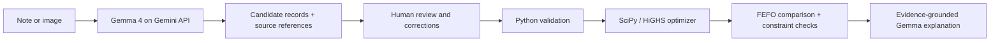

# FreshRoute AI 🌱

[Live app on Cloudflare Workers](https://freshroute.dakshx.workers.dev/) · [Public source](https://github.com/daksh1403/freshroute)

### A stock-note photo should be enough to start planning a delivery.

We built FreshRoute for **PS 07 at Bugged Out! — IEEE RAS VIT Chennai**. The problem sounded simple: send fresh produce to the right markets before it spoils. But the earliest-expiring batch is not always the best batch for every destination. Demand, prices, travel time and shared vehicle capacity all compete.

Our first version solved that allocation problem. For the next version, we asked a more practical question: **what if the stock is written in a notebook instead of a clean spreadsheet?**

That became **FreshRoute Intelligence**, powered by **Gemma 4**.

## What we made

- **Read a stock note or image.** Gemma extracts candidate inventory, demand and market-price records with the source words attached. Missing information stays missing.
- **Check it before using it.** The operator sees the original source, uncertain fields and editable records. Nothing enters the scenario until they confirm it.
- **Calculate the actual dispatch.** Our Python optimizer chooses quantities and destinations, checks shelf life and capacity, and compares the result with a feasible FEFO baseline.
- **Ask why.** Gemma explains a bounded set of independently recomputed solver facts. The operator can open the exact evidence behind each citation.
- **Try a disruption in plain English.** Gemma can propose supported changes such as a three-hour delay on a named route. The operator reviews the change; the optimizer does the recalculation.

This is not a chatbot making delivery guesses. **Gemma reads and interprets; the mathematical engine calculates.**

## Why Gemma 4?

A solver cannot read a handwritten note or understand an informal supplier message. We use `gemma-4-26b-a4b-it` through the official Google GenAI JavaScript SDK and Gemini API to turn that information into a proposal a person can verify.

We do not swap in a Gemini model and call it Gemma. The app displays the requested model, returned model version and measured request latency. Since schema-constrained output support has not been verified for this model, we request JSON and validate it strictly in our own code.



## Why Cloudflare Workers?

Workers serves the app and runs the small API layer that calls Google. The Gemini key stays in a Worker secret, never in the browser bundle. The larger Python/SciPy optimization engine runs in a browser worker through Pyodide, so the deployment does not need a paid Python container.

Core plans stay in the browser. AI requests send only the selected source or the displayed evidence to Google. The first hosted browser load fetches pinned Pyodide assets through the Worker’s cache; once loaded, the optimizer does not need the AI service.

## Try it locally

Use Python 3.11+ and Node 22+.

```sh
git clone https://github.com/daksh1403/freshroute.git
cd freshroute
python3 -m venv .venv
source .venv/bin/activate
python -m pip install -e '.[test]'
npm ci
cp .dev.vars.example .dev.vars
# Put your own GEMINI_API_KEY in .dev.vars. Do not commit it.
python scripts/build_web.py
npx wrangler dev
```

Open the URL printed by Wrangler. For the original local dashboard, run `streamlit run app.py`. The solver also works without either interface:

```sh
python -m freshroute solve examples/demo --output reports/demo
python -m freshroute solve path/to/scenario.json --output reports/imported
python -m pytest -q
npm run test:ai
python -m freshroute benchmark --output reports/benchmark
```

CSV table directories and Excel workbooks work too. [Technical notes and input format](docs/TECHNICAL.md) cover columns, units, assumptions and the exact model.

## The demo we want judges to try

1. Open **AI inventory import** and choose the labeled example note or an image in `examples/ai`.
2. Run the real Gemma extraction. Check quantities, units, shelf life and source references.
3. Choose append or replace, correct anything uncertain, and confirm the records.
4. Open the resulting plan and compare real net revenue, spoilage and demand fulfillment with FEFO.
5. In **AI what-if**, ask: “What if route R-CHG is delayed by three hours?” Review and confirm the proposed operation.
6. Inspect the updated allocation, then ask Gemma to explain the verified evidence.

No API key? The original optimization dashboard still works. The AI screens show the service as unavailable rather than pretending to infer anything.

## What we have actually measured

The original synthetic optimization benchmark has **23 scenarios**, with zero constraint violations and no revenue regressions against FEFO in our recorded runs. Tiny cases are also checked against brute-force enumeration.

On the included synthetic dispatch dataset, FEFO earns **₹19,811** and the economic optimum earns **₹21,123**. There is a trade-off: modeled spoilage rises from **0 to 110 kg** under the supplied disposal penalties. We show this instead of claiming every metric improves.

A real Gemma 4 account/model check succeeded with the exact requested model; that initial request took **1.49 seconds**. This is one observed request, not a latency guarantee. Live extraction evaluation is separate from unit tests; see the measured results and status in [the AI evaluation notes](docs/AI_EVALUATION.md).

All example inputs are synthetic. The handwriting-style image uses a font; it is not evidence of accuracy on actual human handwriting. We have not measured real-world prediction accuracy or an official competition score.

## A few limits we are honest about

- A person must check AI output. Source citations and numeric checks reduce errors; they do not prove that an image was read correctly.
- Unknown box weights, unreadable quantities and unclear shelf life require manual correction. Supplier buying prices are not silently treated as market selling prices.
- We plan one unexecuted dispatch wave. We do not model trip sequencing, committed shipments, forecasting or live warehouse state.
- Markdown suggestions are scenarios. We do not assume a discount creates more customers.
- Gemma API access, quotas and the initial runtime download depend on external services. The standalone optimizer does not.

## Build and deploy

```sh
npm run deploy
# Set the server-side secret for the deployed Worker:
npx wrangler secret put GEMINI_API_KEY
```

The source is public at [github.com/daksh1403/freshroute](https://github.com/daksh1403/freshroute). Original FreshRoute code is [MIT licensed](LICENSE). Gemma, the API and bundled libraries keep their own licenses and terms. We are using Gemma, not claiming that we trained it or built a new model harness.

Contributions are welcome; start with [CONTRIBUTING.md](CONTRIBUTING.md).
